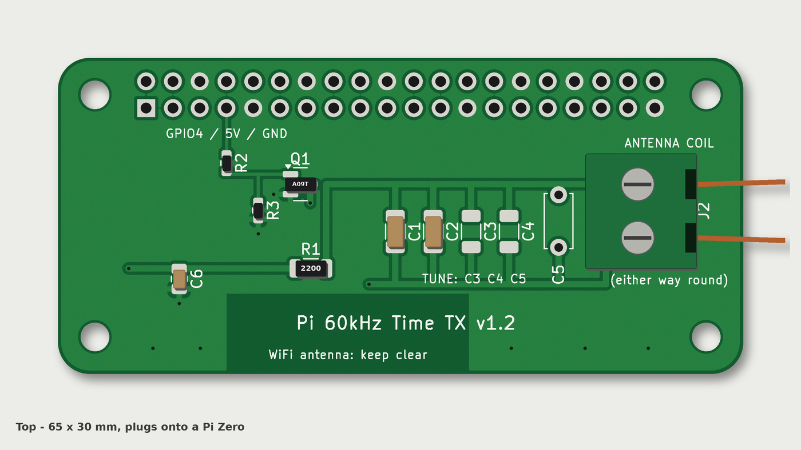
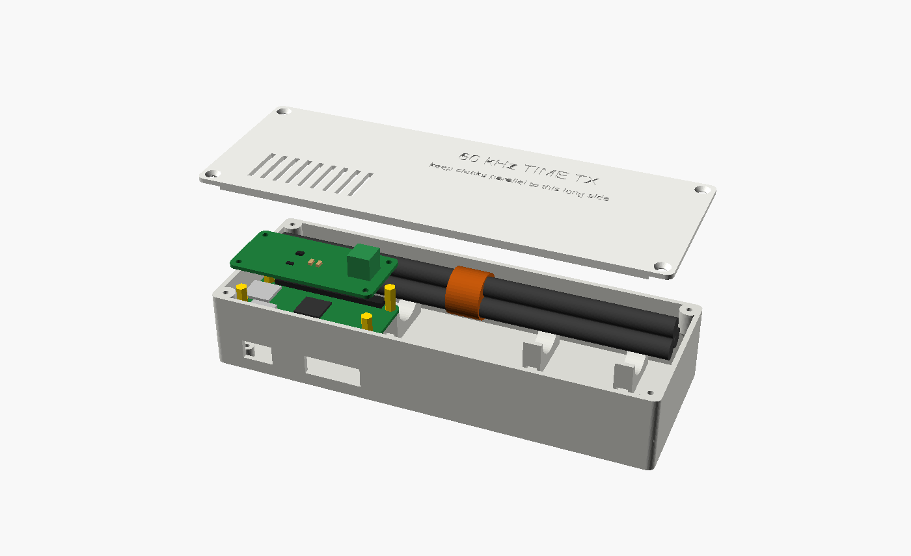
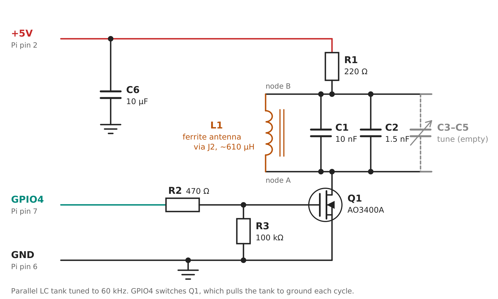

# time-signal

A radio time-signal transmitter for the Raspberry Pi. It sends **JJY**, **MSF**,
**WWVB** or **DCF77** so radio-controlled watches and clocks set themselves,
wherever you live.

This fork adds a hardware design (a Pi Zero pHAT, ferrite antenna and
3D-printed case), a web control panel, and scripts to turn a Pi into a
plug-and-play gift for fellow watch enthusiasts.

| pHAT | Enclosure |
|---|---|
|  |  |

## Where to start

| I want to… | Go to |
|---|---|
| Understand the circuit | [hardware/schematic](hardware/schematic/README.md) |
| Try it on a breadboard | [hardware/breadboard](hardware/breadboard/README.md) |
| Wind and tune the antenna | [hardware/antenna](hardware/antenna/README.md) |
| Order the assembled PCB | [hardware/pcb](hardware/pcb/README.md) |
| Print the case | [hardware/enclosure](hardware/enclosure/README.md) |
| Run it on my own Pi | [Software](#software) below |
| Make units to give away | [pi-setup](pi-setup/README.md) |
| I've been given one | [docs/QUICKSTART.md](docs/QUICKSTART.md) |

## How it works



The Pi generates the carrier (40, 60 or 77.5 kHz) on GPIO4 (pin 7) with its
hardware clock, and switches it on and off each second to encode the time
the way the real station does. A MOSFET drives a ferrite antenna tuned to
the carrier frequency. Range is a few metres, which is plenty for watches on
a shelf nearby. See [hardware](hardware/README.md) for the details.

**Supported Pis:** upstream tested the transmitter on the Pi Zero W, Pi 3
Model B and Pi 4 Model B. The Pi Zero 2 W uses the same chip family as the
Pi 3 and is expected to work. The pHAT and enclosure fit the Zero W and
Zero 2 W.

## Software

### Install

On Raspberry Pi OS:

```bash
git clone https://github.com/jgilfillan/time-signal.git
cd time-signal
sudo ./install.sh
```

The installer:

1. compiles the `time-signal` binary
2. creates a Python virtual environment in `web/.venv` and installs Flask
3. optionally helps you set a static IP address (skipped with `--non-interactive`)
4. installs and starts the `time-signal-web` service on port **8080**

Then open `http://<pi-hostname-or-ip>:8080`.

### Web interface

From any phone or computer on your network you can:

- start and stop transmission, and choose the station
- see the time being sent, whether the clock is synced, and a live log
- turn on **autostart**, so it transmits whenever the Pi boots

**It won't transmit until the Pi's clock has synced with internet time.** A
Pi has no battery-backed clock, so before that it can be hours or days out and
would set your watches wrong. Autostart waits (the page shows *Waiting for
time sync*), and the Start button explains why it can't start yet.

**Each station sends its own country's time** (Japan for JJY, Germany for
DCF77, UK for MSF, UTC with US daylight-saving bits for WWVB), whatever time
zone the Pi is set to.

Settings are saved to `web/config.json`. The service can be tuned with
environment variables in its systemd unit:

| Variable | Default | Purpose |
|---|---|---|
| `TIMESIGNAL_PORT` | `8080` | Web server port |
| `TIMESIGNAL_CONFIG` | `web/config.json` | Where settings are saved |
| `TIMESIGNAL_DEFAULT_SERVICE` | `DCF77` | Station used before any setting is saved |
| `TIMESIGNAL_DEFAULT_AUTOSTART` | `0` | Autostart before any setting is saved |
| `TIMESIGNAL_REQUIRE_TIME_SYNC` | `1` | Refuse to transmit until the clock is synced |

Managing the service:

```bash
sudo systemctl status time-signal-web      # is it running?
sudo journalctl -u time-signal-web -f      # live logs
sudo systemctl restart time-signal-web     # after changing settings
sudo systemctl disable --now time-signal-web   # stop and don't start at boot
```

To uninstall, disable the service as above, then
`sudo rm /etc/systemd/system/time-signal-web.service && sudo systemctl daemon-reload`.

### Command line

```bash
sudo ./time-signal -s JJY60      # transmit the time signal
sudo ./time-signal -s JJY60 -c   # carrier only, for tuning the antenna
```

| Option | Meaning |
|---|---|
| `-s <service>` | `DCF77`, `WWVB`, `JJY40`, `JJY60` or `MSF` |
| `-c` | Carrier only, no time code (for tuning) |
| `-v` | Verbose: show the modulation envelope |
| `-h` | Help |

Run directly, the binary uses the Pi's time zone. For JJY that means running
it with `TZ=Asia/Tokyo` unless the Pi is set to Japan time; the web
interface does this for you.

Build only the binary with `make`. It needs `gcc` and must run as root.

### Requirements

- Raspberry Pi OS (Bookworm or later recommended), with `gcc` and `make`
- Python 3.9 or newer for the web interface

### Tests

```bash
python3 -m unittest discover -s tests -v
```

They stub out the transmitter and `timedatectl`, so they run on any machine
with Flask installed.

## Repository layout

```
time-signal.c, time-services.c, clock-control.c   transmitter (C)
web/                 Flask control panel
install.sh           installs the binary and web service
tests/               web server tests
hardware/            circuit, breadboard, antenna, PCB, enclosure
pi-setup/            scripts for plug-and-play give-away units
docs/QUICKSTART.md   guide for people receiving a unit
```

## Legal

These are very low-power transmitters, but rules on radio transmission vary.
Check yours before using one (in Australia, the ACMA LIPD class licence).

## Credits and references

The transmitter is by Pierre Brial ([harlock974/time-signal](https://github.com/harlock974/time-signal)),
based on Henner Zeller's [txtempus](https://github.com/hzeller/txtempus).
Compared with txtempus, time-signal is written in C, builds without CMake, and
needs no attenuation pin, so the hardware is simpler.

1. Slevin, Cohen and Golkowski (2021), "Wideband VLF/LF Transmission from an
   Electrically-Small Antenna by Means of Time-Varying Non-Reciprocity via
   High-Speed Switches", URSI GASS 2021.
2. Ferrite antennas: <https://www.electronics-notes.com/articles/antennas-propagation/ferrite-rod-bar-antenna/basics-tutorial.php>
3. Designing longer-range transmitters (txtempus discussion): <https://github.com/hzeller/txtempus/issues/8>
4. Andreas Spiess, designing a DCF77 transmitter: <https://youtu.be/6SHGAEhnsYk>
5. Wikipedia: [DCF77](https://en.wikipedia.org/wiki/DCF77),
   [WWVB](https://en.wikipedia.org/wiki/WWVB),
   [MSF](https://en.wikipedia.org/wiki/Time_from_NPL_(MSF)),
   [JJY](https://en.wikipedia.org/wiki/JJY).

Licensed under the GNU GPL v3 (see [LICENSE](LICENSE)).
