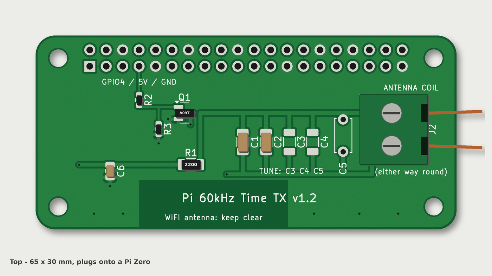

# Hardware

A Raspberry Pi Zero pHAT and a 3D-printed case for transmitting a 60 kHz
time signal (JJY60, WWVB or MSF) to radio-controlled watches and clocks.




## Folders

| Folder | What's in it |
|---|---|
| `pcb/` | KiCad 7 project, schematic PDF, JLCPCB Gerbers/BOM/placement, ordering notes, renders |
| `pcb/scripts/` | Python (KiCad `pcbnew`) scripts that generated the schematic and board |
| `enclosure/` | OpenSCAD source, printable STLs, print and assembly notes |
| `docs/` | Breadboard build guide (Word), breadboard layout, simple circuit diagram |

## Circuit (pHAT v1.2)

A parallel LC tank, switched by a MOSFET from GPIO4. This is the circuit that
was tested on the breadboard.

- 5 V → R1 220 Ω → tank node B
- Ferrite antenna coil (screw terminal J2), C1 10 nF and C2 1.5 nF (C0G) in
  parallel between node B and node A. C3/C4 (1206) and C5 (leaded) are empty
  spots for trimming.
- Q1 AO3400A: drain on node A, source to GND, gate from GPIO4 through R2 470 Ω,
  R3 100 kΩ pull-down keeps it off while the Pi boots. C6 10 µF across 5 V.
- 11.5 nF resonates at 60 kHz with about 610 µH.

The board is 65 × 30 mm, mounts on a Pi Zero W / Zero 2 W with the 40-pin socket
underneath, and is fully assembled by JLCPCB (both connectors included).
The strip above the Pi's built-in Wi-Fi antenna (port edge, between the
mini-HDMI and USB sockets) has no copper, so the board doesn't block Wi-Fi.

To order, see [`pcb/ORDERING.md`](pcb/ORDERING.md).

## Antenna

Three 9 × 180 mm ferrite rods (Jaycar LF1012) taped in a triangle, with ~55
turns of 0.25 mm enamelled copper wire in a tight single layer at the centre.
Details and tuning are in [`docs/60kHz_Antenna_Build_Guide_v4.docx`](docs/).

## Enclosure

194 × 66 × 36 mm, base + screw-on lid, prints in PLA/PETG without supports
on a bed at least 200 mm long. See [`enclosure/ENCLOSURE.md`](enclosure/ENCLOSURE.md).

## Regenerating the board files

The KiCad files can be edited directly in KiCad 7+. They were generated by the
scripts in `pcb/scripts/`, which need KiCad's Python module (`pcbnew`):

```bash
cd hardware/pcb
python3 scripts/gen_sch.py pi_time_tx.kicad_sch
kicad-cli sch export netlist -o /tmp/net.net pi_time_tx.kicad_sch
python3 scripts/gen_pcb.py pi_time_tx.kicad_pcb /tmp/net.net
python3 scripts/fill_drc.py pi_time_tx.kicad_pcb /tmp/drc.rpt   # fills zones, runs DRC
```

Then set the drill/place origin to the board's bottom-left corner (100, 130 mm)
before exporting Gerbers and the placement file. If you edit the board by hand
in KiCad, don't re-run the generators; they'd overwrite your changes.
