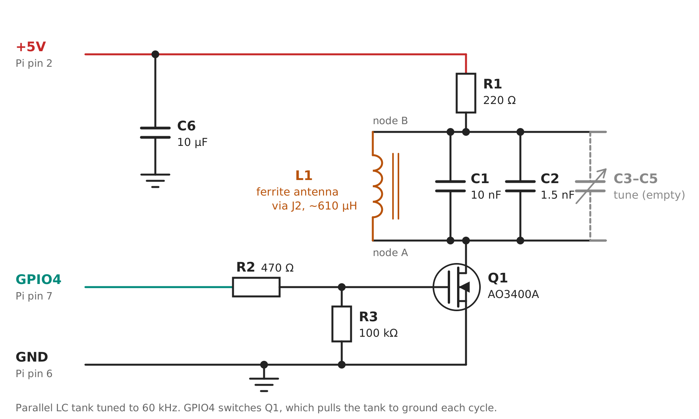
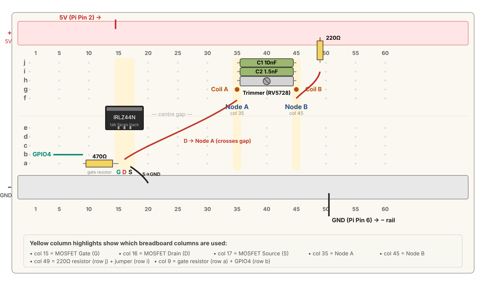
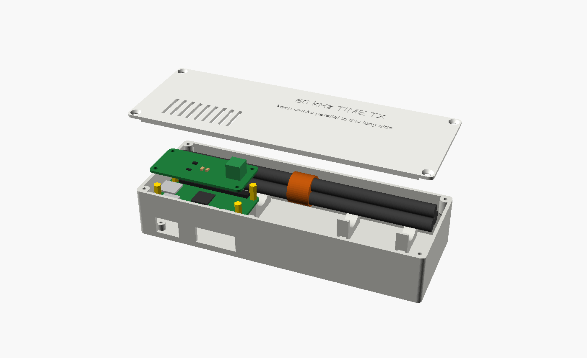

# Hardware

Everything needed to build the 60 kHz transmitter (JJY60, WWVB or MSF), from a
breadboard prototype to a finished, boxed unit.

| | Section | What's there |
|---|---|---|
|  | [**Circuit**](schematic/README.md) | How it works, simple diagram, full KiCad schematic, simpler alternatives |
|  | [**Breadboard**](breadboard/README.md) | Parts list, hole-by-hole layout, wiring and troubleshooting |
|  | [**pHAT PCB**](pcb/README.md) | KiCad project and files to order it fully assembled from JLCPCB |
| | [**Antenna**](antenna/README.md) | Winding the 3-rod ferrite coil and tuning it to 60 kHz |
|  | [**Enclosure**](enclosure/README.md) | 3D-printable case for the Pi, pHAT and antenna |

## Suggested order

1. Read the [circuit](schematic/README.md) overview.
2. Wind the [antenna](antenna/README.md).
3. Prove it on the [breadboard](breadboard/README.md) and tune it.
4. Order the [pHAT](pcb/README.md) and print the [enclosure](enclosure/README.md).
5. Set up the Pi, either for yourself (see the [main README](../README.md#software))
   or as a give-away unit with [pi-setup](../pi-setup/README.md).

## Folder layout

```
hardware/
├── schematic/   circuit_diagram.png, schematic.png/.pdf, alternative circuit
├── breadboard/  layout (.png and interactive .html), build notes
├── antenna/     winding and tuning guide
├── pcb/         KiCad project, JLCPCB Gerbers/BOM/CPL, renders, generator scripts
└── enclosure/   OpenSCAD source, STLs, renders, print notes
```
