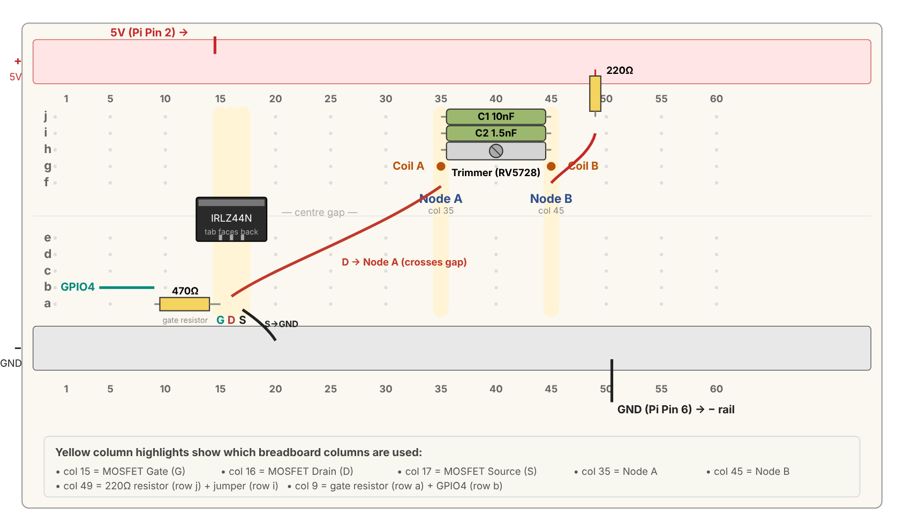

# Breadboard build

Build the transmitter on a breadboard first to prove your antenna and tune it.
This is the same [circuit](../schematic/README.md) as the pHAT, using
through-hole parts from Jaycar.

Open [breadboard_layout.html](breadboard_layout.html) in a browser for the
full interactive version with tables. The layout is for a 60-column
breadboard with row **a** at the bottom and row **j** at the top.

## Parts

| Part | Value | Notes |
|---|---|---|
| MOSFET | IRLZ44N | Logic-level N-channel, TO-220. Pins left to right (label facing you): G – D – S. The metal tab is the drain. |
| R2 (gate) | 470 Ω, ¼ W | GPIO4 → gate |
| R1 (feed) | 220 Ω, ¼ W | 5 V → tank. Dissipates at most ~0.11 W. |
| C1 | 10 nF, 100 V polyester (greencap) | |
| C2 | 1.5 nF, 100 V polyester (greencap) | |
| Trimmer | Jaycar RV5728 tuning capacitor | Fine tuning, 3 pins (see below) |
| Antenna | 3-rod ferrite coil | See [antenna guide](../antenna/README.md) |
| Jumper wires, breadboard | | |

Avoid ceramic disc capacitors (lossy and drift with temperature) and
electrolytics (polarised).

## Placement

| Component | Position |
|---|---|
| IRLZ44N | One pin per hole in row **e**: G col 15, D col 16, S col 17. Tab facing away. |
| 470 Ω gate resistor | Col 9 row a ↔ col 15 row a |
| 220 Ω resistor | + rail ↔ col 49 row j |
| C1 10 nF | Col 35 row j ↔ col 45 row j |
| C2 1.5 nF | Col 35 row i ↔ col 45 row i |
| Trimmer | Col 35 row h ↔ col 45 row h (short wires) |
| Coil lead A | Col 35 row g |
| Coil lead B | Col 45 row g |

Columns 35 and 45 are the two sides of the tank: **node A** and **node B**.

## Wires

| From | To |
|---|---|
| Pi pin 2 (5 V) | + rail |
| Pi pin 6 (GND) | − rail |
| Pi pin 7 (GPIO4) | Col 9 row b |
| Col 17 row b (source) | − rail |
| Col 16 row b (drain) | Col 35 row f (node A) — crosses the centre gap |
| Col 49 row i (220 Ω) | Col 45 row f (node B) |

Rows a–e and f–j aren't connected across the centre gap, which is why the
drain needs its own jumper to node A.

## The RV5728 trimmer

It has three pins. On this style of radio tuning capacitor the middle pin is
usually the common (rotor) and each outer pin is one section, so use the
**middle pin plus one outer pin**. If you have a capacitance meter, use the
pair that reads highest. The trimmer only changes the total by about 1 %;
for bigger changes, swap C2 (see [tuning](../antenna/README.md#tuning)).

## Test

1. Build and install the software on the Pi (see the [main README](../../README.md#software)).
2. Run a plain carrier: `sudo ./time-signal -s JJY60 -c`
3. Tune as described in the [antenna guide](../antenna/README.md#tuning).
4. Run the real signal: `sudo ./time-signal -s JJY60`, or start it from
   the web page.

## Troubleshooting

| Problem | Likely cause | Fix |
|---|---|---|
| No signal at all | Wiring, or software not running | Check every connection; check the drain jumper crosses the gap |
| Very short range | Antenna not at resonance | Retune; if the trimmer can't reach it, swap C2 |
| Clock never syncs | Watch not set to the right station | Set the watch to receive JJY (or match `-s` to your watch) |
| MOSFET warm | Shouldn't be: it carries ~20 mA | Look for a short between drain/tank and 5 V |
