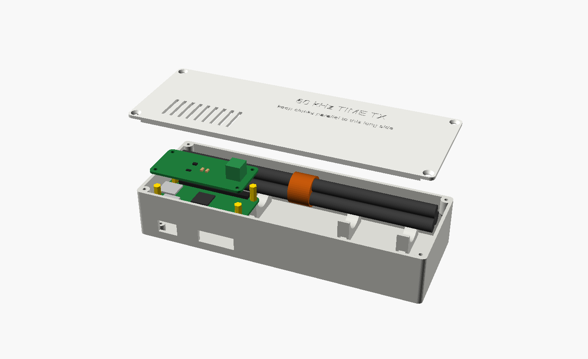
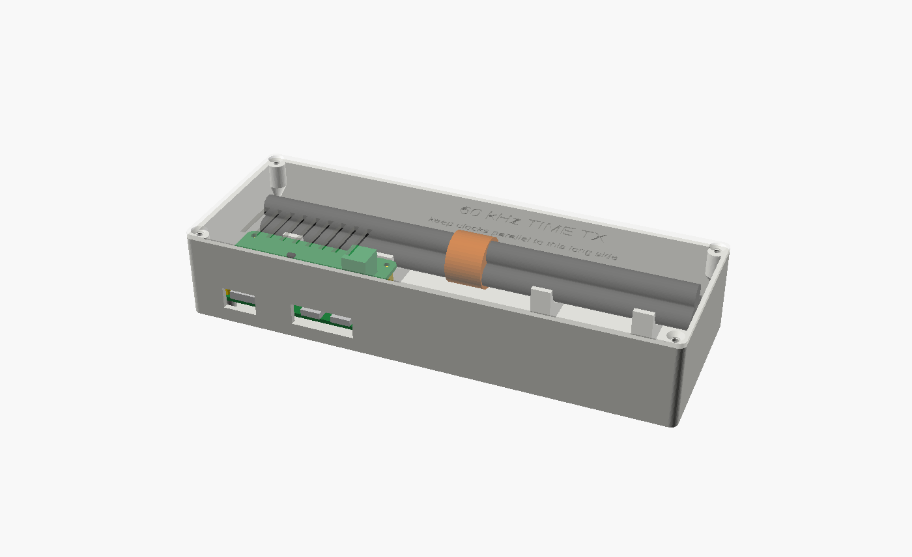
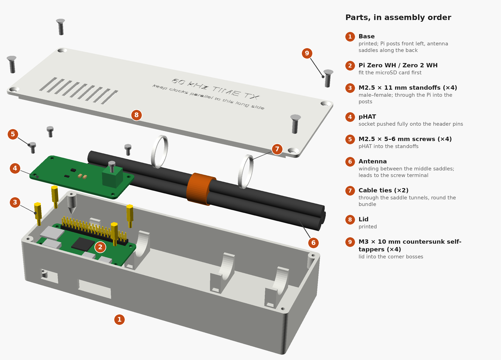
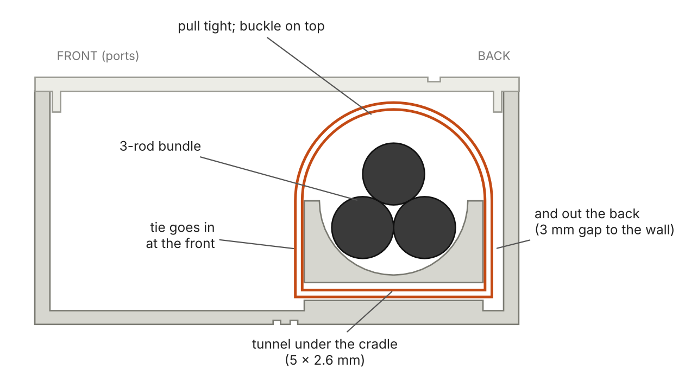
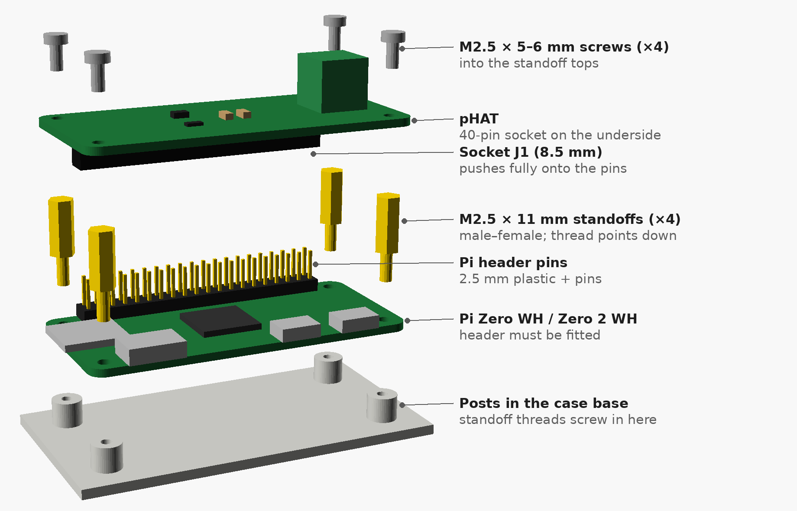
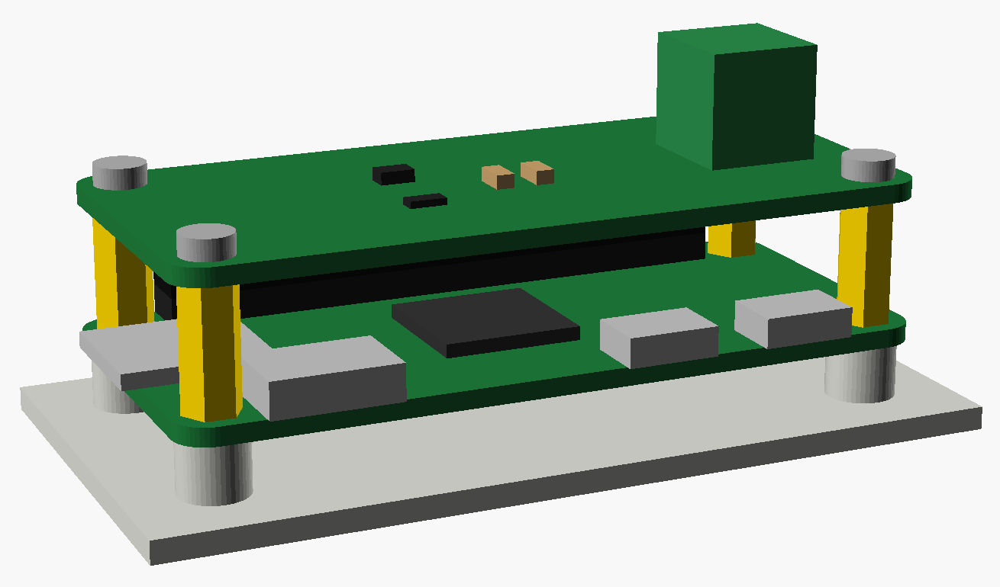

# 3D-printed enclosure

One box holds the Raspberry Pi Zero, the [pHAT](../pcb/README.md) stacked on
it, and the 3-rod [ferrite antenna](../antenna/README.md) lying along the back
wall.

| Exploded | Assembled |
|---|---|
|  |  |

- Outside size: 194.4 x 70.4 x 36 mm (base 34 mm + lid 2 mm)
- Parts: `base.stl`, `lid.stl` (the lid is already flipped for printing)
- Source: `pi_time_tx_enclosure.scad` (OpenSCAD; every dimension is a named variable at the top).
  Set `PART` to `full_exploded` for the numbered exploded view, or `stack_exploded` /
  `stack_assembled` for the close-ups of the Pi and pHAT.

## Printing
- Needs a bed at least 200 mm long in one direction (Ender 3, Prusa, Bambu P1/X1/A1 are fine;
  a 180 mm bed such as the A1 mini is too small).
- PLA or PETG, 0.2 mm layers, 3 walls, 15-20 % infill, **no supports**.
- Base: print open side up. Lid: print as exported (flat face down, lip up).
- Material and time (PrusaSlicer, PLA, 0.2 mm, 3 walls, 18 % infill): base about 80 g and
  7 h 15 min; lid about 29 g and 2 h 45 min.
- Everything is designed to print without supports. The only overhangs are short bridges
  (port openings up to 26 mm, the microSD slot, the 5 mm cable-tie tunnels) and the
  lid-screw bosses, which sit on ramps of about 40 degrees.
- PrusaSlicer warns "long bridging extrusions" on the lid. That comes from the engraved
  text on its outer face (the face on the bed), and is safe to ignore. Don't turn supports on,
  or they'll fill the letters.

## Hardware
| Qty | Part | Used for |
|-----|------|----------|
| 1 | Raspberry Pi Zero **WH** or Zero 2 **WH** (the "H" means the 40-pin header is already soldered on) | the computer; a plain Zero W / Zero 2 W needs a 2 x 20 male header soldered on first |
| 4 | M2.5 x 11 mm male-female hex standoff (6 mm thread, brass or nylon) | between the Pi and the pHAT |
| 4 | M2.5 x 5 or 6 mm screw | pHAT into the standoffs |
| 4 | M3 x 10 mm countersunk self-tapping screw | lid |
| 2 | nylon cable ties, 2.5 mm wide, at least 150 mm long | hold the antenna in its saddles |
| 4 | stick-on rubber feet (optional) | |

Keep metal screws and standoffs to the Pi end of the box; nothing metal sits near the ferrite.

## Assembly

1. Flash and fit the microSD card first. Once the Pi is in, the card sits about 4.5 mm in from
   the left wall: swap it later with the lid off, using tweezers or small pliers (the slot in the
   left end lets you see it and give it a push).
2. Screw the 4 male-female standoffs down through the Pi's mounting holes into the printed
   posts in the base. The male thread self-taps into the 2.2 mm holes; don't overtighten.
   The Pi's ports line up with the openings in the front wall.
3. Plug the pHAT onto the Pi and fix it to the standoffs (details below).
4. Thread a cable tie through the tunnel under each of the two middle saddles, in at the
   front face and out through the gap behind it, and leave both ends standing up. Lay the
   antenna bundle in the four saddles, with the winding in the gap between the middle two.
   Bring each tie over the top of the bundle, buckle it on top, pull it snug (ferrite is
   brittle, so don't crank it) and trim the tail. See the cross-section below.
5. Run the two coil leads forward to the screw terminal (J2) and tighten them in, either way
   round. Keep the leads tidy and away from the Pi.
6. Fit the lid and screw it down. Power comes in through the Pi's micro-USB PWR port.

### Cable ties

Each of the middle two saddles has a 5 × 2.6 mm tunnel under its cradle. It's open at
both ends: at the front face of the saddle, and into a 3 mm gap between the back of the
saddle and the back wall. The tie loops through the tunnel and over the bundle, so it
holds the rods down without anything metal near the ferrite.

### Fitting the pHAT to the Pi

*Fitted: the pHAT rests on the standoffs with the socket fully on the pins.*

The standoffs are 11 mm because the Pi's header plastic (2.5 mm) plus the
pHAT's socket (8.5 mm) is 11 mm. At that height the socket is fully pushed
onto the pins and the pHAT also sits on the standoffs, so the boards are
clamped together without straining the connector.

**Before you start:** the Pi needs a 40-pin male header on its top side. A
Pi Zero WH or Zero 2 WH has one fitted at the factory; a plain Zero W or
Zero 2 W doesn't. Unplug the power.

1. With the Pi already held in the base by the four standoffs (threaded holes
   facing up), hold the pHAT socket-side down with its four holes over the
   standoffs. It only fits one way: turned round, the socket would be at the
   wrong edge and miss the header. If all four holes line up, the socket lines
   up with the pins too.
2. Press straight down, evenly over both ends of the socket, until the socket
   bottoms out on the header plastic and the board sits on the standoffs.
   Don't push on the screw terminal.
3. Put an M2.5 x 5 or 6 mm screw into each standoff. Tighten them just snug;
   overtightening bends the board.

**If it doesn't sit right**
- *A gap between the pHAT and the standoffs:* the socket isn't fully on. Press
  again over the socket. If it still won't close, the Pi's header is probably
  a taller type; use 12 mm standoffs or put a washer on each.
- *The pHAT bows when you screw it down:* check the socket is fully home and
  don't tighten further.
- *Taking it off:* remove the screws and lift straight up, rocking gently end
  to end. Prising up one end bends the pins.

**Testing on the bench first:** to tune or test before boxing it, build the
same stack outside the case with M2.5 nuts on the standoffs' male threads
under the Pi. Take the nuts off later and screw the standoffs into the base.

## Placement for best range
The rods radiate as a magnetic dipole along their length. Range is best with the clock's own
antenna parallel to the box: either a little way off one end in line with the rods, or beside
the long side. A clock turned 90 degrees to the box may not pick up the signal at all.

## Checks done
- Both STL files are single, watertight solids.
- The Pi, pHAT, standoffs, screw terminal and antenna were modelled in place and checked for
  collisions with the base and lid: none.
- A 2.4 x 1.0 mm cable tie was modelled along its path (through the tunnel, up both faces of
  the saddle and over the bundle) and checked against the base, lid and contents: no collisions.
- The Pi/pHAT outline (plus 0.5 mm) and the taped rod bundle were swept straight down from
  above the box: nothing in the base is in the way, so both drop straight in.
- Both parts slice in PrusaSlicer with supports off and no stability warnings (apart from
  the lid text note above).
- Port positions use the Pi Zero's published mechanical drawing (mini-HDMI at 12.4 mm,
  USB at 41.4 mm, PWR at 54.0 mm from the left edge). The openings are oversized so moulded
  cable plugs fit. Print a test strip of the front wall first if your cables are unusually bulky.
