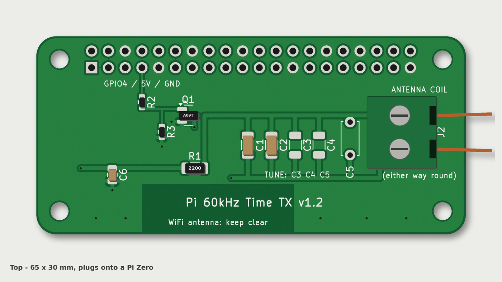
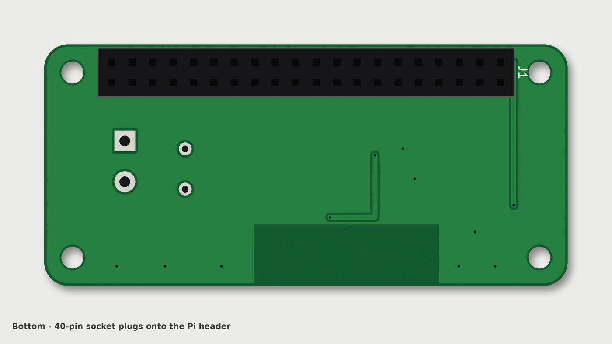

# pHAT PCB (v1.2)

A 65 × 30 mm board that plugs straight onto a Raspberry Pi Zero WH / Zero 2 WH
(a Zero W or Zero 2 W with the 40-pin header fitted; a plain Zero W / Zero 2 W
needs a 2 × 20 male header soldered on first).
JLCPCB makes and fully assembles it, including both connectors. You only
screw the antenna leads into the terminal.

| Top | Bottom |
|---|---|
|  |  |

- Circuit: see [../schematic](../schematic/README.md). Parallel LC tank,
  AO3400A MOSFET, C3/C4/C5 empty for tuning.
- **Wi-Fi keep-out:** the strip along the bottom edge (over the Pi's built-in
  Wi-Fi antenna, between the mini-HDMI and USB sockets) has no copper on
  either layer, so the board doesn't block Wi-Fi or Bluetooth. Its placement
  for the Zero 2 W is inferred from the Zero W's antenna position.
- Design rule check passes with every connection made.

## Files

| File | What it is |
|---|---|
| `pi_time_tx.kicad_pro/.kicad_sch/.kicad_pcb` | KiCad 7 project |
| `pi_time_tx_gerbers_JLCPCB.zip` | Gerbers + drill files to upload |
| `jlcpcb_bom.csv` | Parts list with LCSC numbers (9 lines) |
| `jlcpcb_cpl.csv` | Placement file (9 parts) |
| `scripts/` | Python scripts that generated the board (see below) |

## Ordering 5 boards at JLCPCB

1. jlcpcb.com → **Order now** → upload `pi_time_tx_gerbers_JLCPCB.zip`.
   2 layers, 65 × 30 mm, qty 5, 1.6 mm, lead-free HASL, any colour.
2. Tick **PCB Assembly**, PCBA qty 5.
   - Choose **Standard** assembly (Economic can't do through-hole parts or
     both sides).
   - Assembly side: **both sides**. J1 goes on the bottom, everything else
     on the top.
3. Upload `jlcpcb_bom.csv` and `jlcpcb_cpl.csv`.
   - C3, C4 and C5 are intentionally left empty.
   - Both connectors are factory-fitted: J1 (40-pin socket, C2977589) and
     J2 (screw terminal, C8465).
4. In the placement preview, check and rotate anything that's wrong:
   - Q1 (SOT-23): pin-1 dot top-left, single pin (drain) on the right.
   - C1, C2, C6, R1, R2, R3 centred on their pads.
   - J1 on the bottom, centred over its 40 holes.
   - J2's wire openings facing the right-hand board edge.

Check prices and stock on the quote screen; four parts carry JLC's
extended-part fee.

| Ref | Part | LCSC |
|---|---|---|
| Q1 | AO3400A, SOT-23 | C20917 |
| R1 | 220 Ω 1206 | C17957 |
| R2 | 470 Ω 0603 | C23179 |
| R3 | 100 kΩ 0603 | C25803 |
| C1 | 10 nF C0G 50 V 1206 | C64713 |
| C2 | 1.5 nF C0G 50 V 1206 | C105972 |
| C6 | 10 µF 25 V 0805 | C15850 |
| J1 | 2 × 20 female header, 8.5 mm | C2977589 |
| J2 | 2-pin screw terminal, 5.08 mm | C8465 |

## After the boards arrive

- Wind the [antenna](../antenna/README.md) and screw its two leads into J2
  (either way round).
- Mount on the Pi with M2.5 × 11 mm male-female standoffs (8.5 mm socket plus
  the Pi header's 2.5 mm plastic). Step-by-step instructions are in the
  [enclosure guide](../enclosure/README.md#fitting-the-phat-to-the-pi), which
  is designed for this stack.
- If a board needs trimming, add a 1206 C0G capacitor at C3/C4 or a leaded
  one at C5, and tune as in the [antenna guide](../antenna/README.md#tuning).

## Editing or regenerating

The KiCad files can be edited directly in KiCad 7 or later. They were
generated by the scripts in `scripts/`, which need KiCad's Python module
(`pcbnew`):

```bash
cd hardware/pcb
python3 scripts/gen_sch.py pi_time_tx.kicad_sch
kicad-cli sch export netlist -o /tmp/net.net pi_time_tx.kicad_sch
python3 scripts/gen_pcb.py pi_time_tx.kicad_pcb /tmp/net.net
python3 scripts/fill_drc.py pi_time_tx.kicad_pcb /tmp/drc.rpt   # fills zones, runs DRC
```

Before exporting Gerbers and the placement file, set the drill/place origin
to the board's bottom-left corner (100, 130 mm). If you edit the board by
hand in KiCad, don't re-run the generators, because they'd overwrite your
changes.
