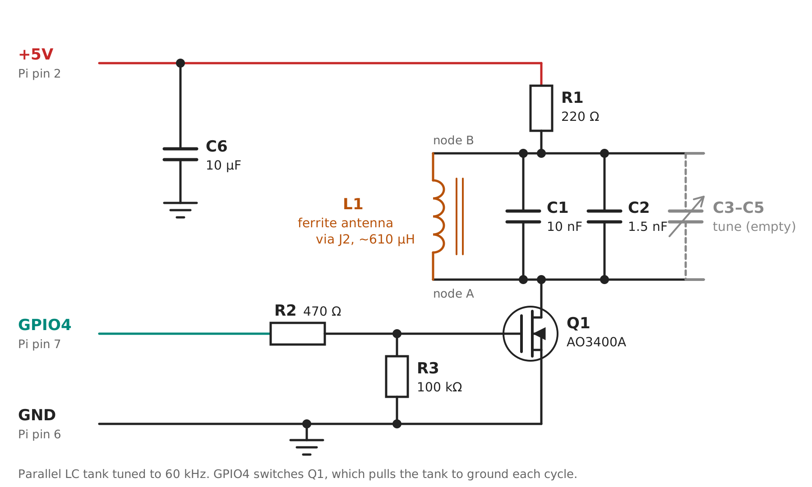
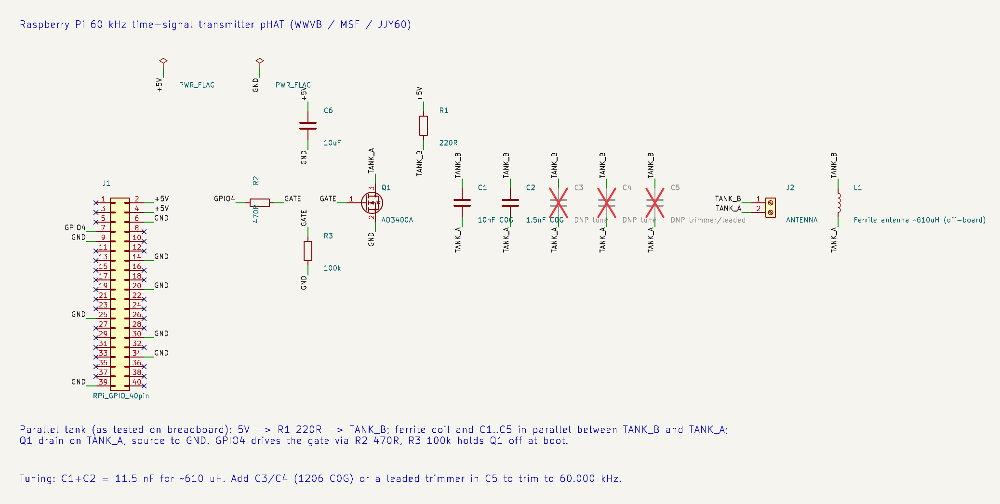
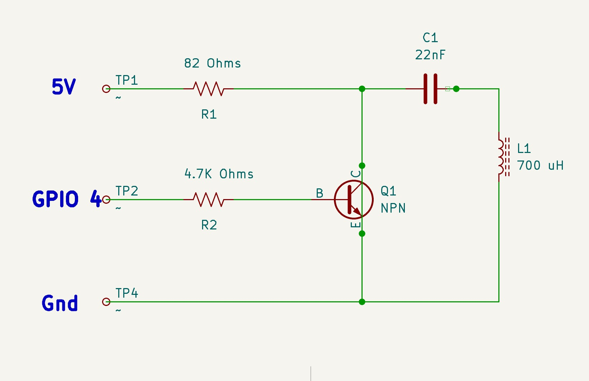

# Circuit

The transmitter is a parallel LC tank tuned to 60 kHz, switched on and off by
a MOSFET driven from the Pi's GPIO4. This is the circuit built and tested on
the breadboard, and the one used on the pHAT.

## How it works

- `time-signal` makes GPIO4 output a 60 kHz square wave (the Pi's GPCLK0
  clock), turning it on and off each second to encode the time.
- **Q1** (AO3400A on the pHAT, IRLZ44N on the breadboard) switches node A of
  the tank to ground at 60 kHz. **R2** (470 Ω) limits the gate current;
  **R3** (100 kΩ, pHAT only) keeps Q1 off while the Pi boots.
- **R1** (220 Ω) feeds the tank from 5 V and limits the current to about
  20 mA, so nothing gets warm.
- The **ferrite antenna coil (L1)** and **C1 + C2** (10 nF + 1.5 nF) resonate
  at 60 kHz. 11.5 nF needs about 610 µH of coil. **C3–C5** are spare spots for
  trimming the capacitance (a trimmer capacitor on the breadboard).
- **C6** (10 µF, pHAT only) steadies the 5 V supply.

| Pi pin | Signal |
|---|---|
| 2 (and 4) | 5 V |
| 6 (and other GND pins) | Ground |
| 7 | GPIO4 — 60 kHz carrier |

Tuning formula: C = 1 / (4π² × L × f²). At 60 kHz, 500–700 µH needs
10–14 nF. See [the antenna guide](../antenna/README.md#tuning) for tuning a
built antenna.

## Full schematic (KiCad)

[schematic.pdf](schematic.pdf) is the printable version. The KiCad source is
[`../pcb/pi_time_tx.kicad_sch`](../pcb/pi_time_tx.kicad_sch).

## Simpler circuits

If you just want to try the software first:

- **Coil only:** a loop of wire (about 14 turns, 13 mm across) in series with
  a 220 Ω resistor between GPIO4 (pin 7) and GND. Range is roughly 10–45 cm.
- **NPN transistor instead of a MOSFET:** use a 4.7 kΩ base resistor from
  GPIO4.

  

  Note this original version puts the capacitor in *series* with the coil.
  The circuit above uses a parallel tank because that's what was tested
  with the ferrite antenna here.

The upstream project, [harlock974/time-signal](https://github.com/harlock974/time-signal#circuits),
also shows a two-MOSFET version that reached about 10 m.
